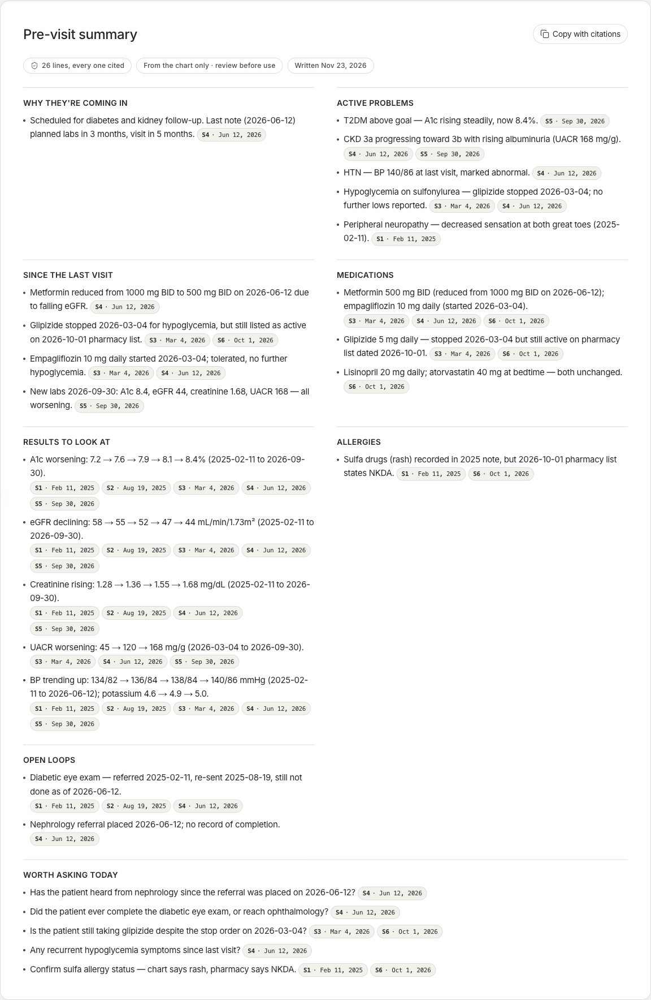
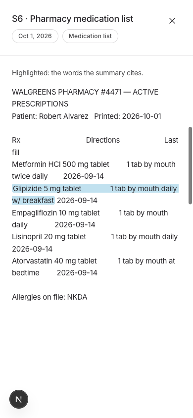

# Pre-Visit Summary Kit

An open-source pre-visit chart summary built on the [Sully API](https://sully.ai/api). Load a patient's prior notes, lab reports and medication list (or a FHIR Bundle from the EHR). [Sully Text to JSON](https://docs.sully.ai/text-to-json.md) pulls typed facts out of every document, plain code lines them up across documents, and [Sully M1](https://docs.sully.ai/sully-m1.md) writes one page the clinician can read in a minute. Every line cites the document it came from, and one click shows the exact words.

<p>
  
  
</p>

## What it does

- **Any chart format.** Paste or upload visit notes, lab reports and medication lists (.txt, .md), or upload a FHIR R4 Bundle. FHIR problem lists, medications, allergies and results are already structured, so they skip extraction; notes inside the Bundle are read like any other note.
- **Facts from every document.** Text to JSON extracts problems, medications (started, changed, stopped, with dates), results, allergies and open items (referrals, tests, screenings) into a JSON Schema you can edit. Results are cached per document, so adding one note only pays for that note.
- **Catches what hides between documents.** Plain rules, not the model, find: a drug a note stopped that a later list still shows, a dose change the list never picked up, results getting worse over time, allergy records that disagree, and referrals with no record they happened.
- **One page, every line cited.** M1 writes eight short sections: why they're coming in, active problems, what changed since the last visit, medications, results to look at, allergies, open loops and 3 to 5 things worth asking today. No diagnoses, no new plans.
- **Checked by the server.** A line with no valid citation is removed. Quotes are matched against the source. Every rule-based flag must appear; if M1 leaves one out, the app adds it and labels it.
- **Click to verify.** Each citation opens the source with the quoted words highlighted.
- **Built for developers.** Every Sully request is logged with latency, request ID, token usage and a copyable curl. Demo mode runs without keys.

## Two ways to use it

**1. Run this app**

```bash
git clone https://github.com/aniquethaplawala/previsit-summary-kit
cd previsit-summary-kit/app
cp .env.example .env.local   # add your Sully keys, or leave empty for demo mode
npm install
npm run dev
```

Open http://localhost:3000, log in as `dr.chen@example.com` / `change-me`, click **New chart** and load a sample patient. Change the default passwords first.

**2. Build it yourself with one prompt**

[`BUILD_PROMPT.md`](BUILD_PROMPT.md) is a single prompt for an AI coding agent (Claude Code, Cursor, Codex) that rebuilds this app from an empty folder, including the sample patients and the eval it must pass.

## How a summary is made

1. **Text to JSON** (`POST /v1/utils/text-to-json`), one request per text document, up to 4 at once. The schema's field descriptions carry the rules, for example "placing or re-sending a referral is pending, not done". Each result includes short exact quotes.
2. **Merge** (plain code in [`lib/facts.ts`](app/lib/facts.ts)). Medication histories, result series with trends, allergy conflicts and open loops, each with the sources it came from. The rules produce a list of flags.
3. **M1** (`POST /openai/v1/chat/completions`, model `sully-m1`), one call with JSON output. It gets the visit details, the flags it must cover, the merged facts and every source in full.
4. **Validate** ([`lib/summary.ts`](app/lib/summary.ts)). Drop uncited lines, match each quote in its source, add the sources M1 left out for facts a line states (every value in a trend, both sides of a conflict), and add any flag M1 missed.

## Tested on five synthetic patients

[`app/test-data/`](app/test-data/) has five synthetic charts written for this kit, each with planted traps: primary care diabetes and CKD, heart failure from a FHIR Bundle, pediatric asthma, prenatal care at 32 weeks, and depression medication management (no sex recorded, so no pronouns allowed). [`app/scripts/eval.py`](app/scripts/eval.py) runs all five against the live API and checks every trap is surfaced, no line is uncited, quotes are found, and a second M1 call judges each line against the sources it cites.

Latest run (23 Nov 2026, two full runs in a row, both passed):

| Patient | Documents | Traps surfaced by M1 | Uncited lines | Quotes found in source | Judge: unsupported / advice | Cost | Time |
|---|---|---|---|---|---|---|---|
| Diabetes and CKD (primary care) | 6 | 5/5 | 0 | 55/55 | 0 / 0 | $0.32 | 20 s |
| Heart failure (FHIR Bundle + ED note) | 1 Bundle + 1 note | 6/6 | 0 | 49/50 | 0 / 0 | $0.17 | 18 s |
| Pediatric asthma | 6 | 4/4 | 0 | 43/46 | 0 / 0 | $0.31 | 18 s |
| Prenatal, 32 weeks | 7 | 5/5 | 0 | 51/51 | 0 / 0 | $0.37 | 20 s |
| Depression medication management | 6 | 5/5 | 0 | 45/50 | 0 / 0 | $0.31 | 18 s |

All 25 planted traps were written by M1 itself (the app's safety net added nothing), no uncited line reached the summary, no gendered pronouns for the patient with no sex recorded, and the judge found no unsupported lines and no advice. The few quotes not found word for word are citations the app added from extracted facts; the line still links to the right source, without a highlight. Full output: [`app/eval/RESULTS.md`](app/eval/RESULTS.md).

What testing fixed along the way: "referral placed" was read as done (now pending, in the schema and in code); a later note saying "since glipizide was stopped" counted as a second stop; a note re-mentioning an old result ("FEV1 was 92% in March 2025") became a fake new data point; trend lines cited only the first and last documents (the server now adds the rest); M1 claimed "no ED visits since" with nothing in the chart to say so (now forbidden); routine "return in 4 weeks" showed up as an open loop.

## Cost

At list prices ($0.05 per Text to JSON request; M1 $1.50 per 1M input tokens, $4.60 per 1M output) a summary cost **$0.31 to $0.37 for a chart of 6 to 7 text documents, and $0.17 for the FHIR patient** in our runs. Almost all of it is Text to JSON at $0.05 per document; the M1 call is 1 to 3 cents. Re-running a summary after adding one document costs $0.05 plus the M1 call. A FHIR Bundle is cheaper because its structured parts skip extraction. See [Sully pricing](https://docs.sully.ai/pricing).

## Repo layout

| Path | What it is |
|---|---|
| [`app/`](app/) | The Next.js app (chart loader, summary, facts, sources, API routes) |
| [`app/lib/extract.ts`](app/lib/extract.ts) | The Text to JSON schema and cleanup |
| [`app/lib/fhir.ts`](app/lib/fhir.ts) | FHIR R4 Bundle to dated sources |
| [`app/lib/facts.ts`](app/lib/facts.ts) | Merge rules: medication histories, trends, conflicts, open loops |
| [`app/lib/summary.ts`](app/lib/summary.ts) | The M1 prompt and the citation checks |
| [`app/lib/sully.ts`](app/lib/sully.ts) | Sully client: Text to JSON, M1, call logging |
| [`app/test-data/`](app/test-data/) | Five synthetic patients with planted traps |
| [`app/scripts/eval.py`](app/scripts/eval.py) | The live eval |
| [`BUILD_PROMPT.md`](BUILD_PROMPT.md) | One prompt to rebuild it, plus the checklist before real patient data |

## Before real patient data

This is a working starting point, not a finished medical product. Sign a BAA with Sully (self-serve in the [dashboard](https://dashboard.api.sully.ai)) and every vendor that touches patient data, have clinicians review the rules and the prompt for your specialty, pull documents from your EHR instead of uploads, and use a real database. The full checklist is in [Part 2 of BUILD_PROMPT.md](BUILD_PROMPT.md#before-real-patients-use-it).

The summary is drawn only from the documents you load. It is a draft for clinician review, not medical advice.

## Related

- [Clinical Scribe Kit](https://github.com/aniquethaplawala/clinical-scribe-kit): an AI medical scribe on the Sully API (transcription, notes, codes, EHR JSON)
- [Patient Intake Kit](https://github.com/aniquethaplawala/patient-intake-kit): a chat-based patient intake on Sully M1
- More kits: [sully.ai/build](https://www.sully.ai/build)

## License

MIT. See [LICENSE](LICENSE). The sample patients are synthetic and written for this kit.
